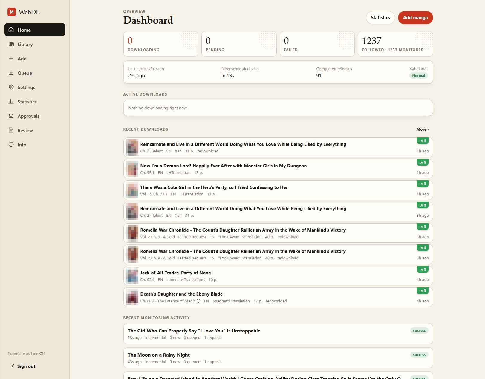
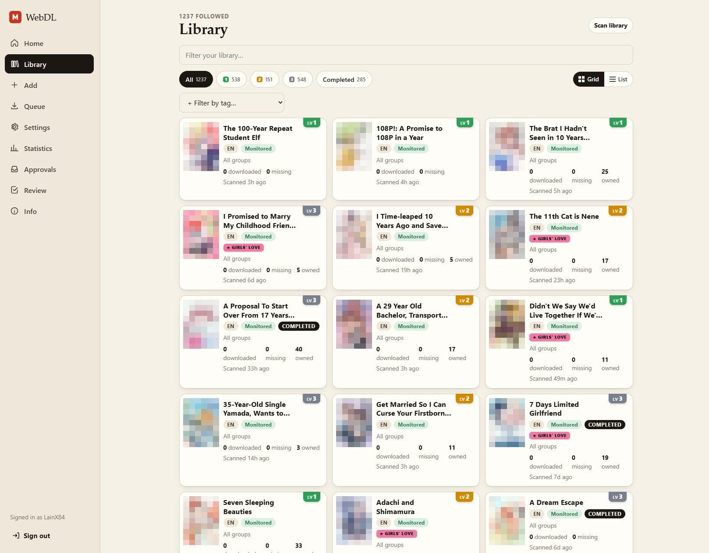
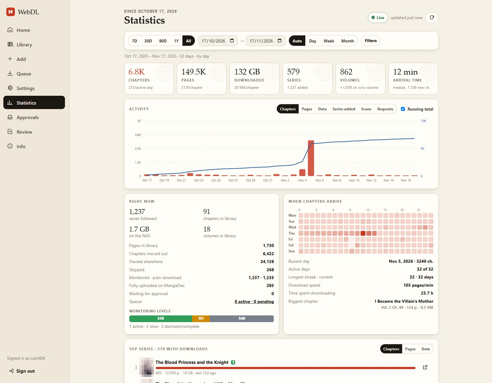

# MangaDex WebDL

A self-hosted download manager for [MangaDex](https://mangadex.org): it follows the manga you choose, notices new
chapters and saves them to your NAS as page images — as uploaded, or converted to PNG, JPEG or WebP — or as CBZ
files, one per chapter or one per complete volume.
FastAPI + React, PostgreSQL, Redis, one image for the web app, worker and scheduler.

**Full documentation, source code and issues: <https://github.com/lainx84/mangadex-webdl>**

<p align="center">
  
</p>

<p align="center">
  
  &nbsp;
  
</p>

## Features

- Add manga by MangaDex URL, UUID or title; choose languages and scanlation groups per title.
- Monitoring every few hours, plus (optional, read-only MangaDex account) the followed feed every 15 minutes.
- Only complete chapters reach the library: pages are downloaded to a staging folder, verified and moved in atomically.
- Chapter folders named for volumes (`Volume 03 Chapter 12 - …`), renamed automatically when MangaDex assigns the volume.
- Manual edits (removed ad pages, moved chapters) are detected and never undone.
- NAS safety: nothing is written unless the share is mounted (sentinel file, filesystem type, write probe).
- Polite by default: shared rate limiter well below MangaDex's limits, pause on 429, full stop on 403.
- Optional output formats: every page as PNG, JPEG or WebP (or a lossless space-saving MIXED mode), one CBZ per
  chapter, one CBZ per complete volume (checked page by page before the chapter folders are deleted).
- Optional read-only CBZ archive: suggests the chapter to continue from.
- Statistics, Approvals, Review, mobile-first UI, mandatory login (Argon2id, CSRF, secure sessions).

## Tags

| Tag | Content |
|---|---|
| `latest` | Newest release |
| `1.x.y` (e.g. `1.1.0`) | That exact release |

Platforms: `linux/amd64`, `linux/arm64`. Also published as `ghcr.io/lainx84/mangadex-webdl`.

## Quick start

The app needs PostgreSQL and Redis: use the Compose stack from the repository.

```sh
git clone https://github.com/lainx84/mangadex-webdl.git && cd mangadex-webdl
cp .env.example .env                 # set MDM_IMAGE=lainx84/mangadex-webdl:latest, MDM_LIBRARY_PATH, PUID/PGID…
sudo ./scripts/init-secrets.sh       # random DB password + empty MangaDex account files
mkdir -p appdata/data appdata/postgres appdata/redis && sudo chown 1000:1000 appdata/data
docker compose up -d
docker exec -it mangadex-webdl mdm init-library      # with the NAS mounted
docker logs mangadex-webdl 2>&1 | grep -A3 "FIRST-RUN SETUP"   # one-time setup token
```

Then open `http://<host>:8098`. Configuration, reverse proxy, NFS mount and CLI are documented in the
[README](https://github.com/lainx84/mangadex-webdl#readme).

## Not affiliated with MangaDex — disclaimer

MangaDex WebDL is an independent, non-commercial project, not affiliated with or endorsed by MangaDex, by any
scanlation group or by any rights holder. The image contains source code only — **no manga, scans or images**.
Everything is downloaded at runtime by each user's own instance, through the official MangaDex API, for personal and
private use, under that user's sole responsibility. Manga belong to their authors and publishers, scanlations to
their groups: support them and buy official releases. Rights holders and scanlation groups can request exclusion by
opening an issue on GitHub. See the full
[disclaimer](https://github.com/lainx84/mangadex-webdl#disclaimer-and-legal-notice).

Thanks to MangaDex and the MangaDex@Home volunteers, and to every scanlation group.

## License

© 2026 LainX84 — [GNU AGPL-3.0-or-later](https://github.com/lainx84/mangadex-webdl/blob/main/LICENSE).
